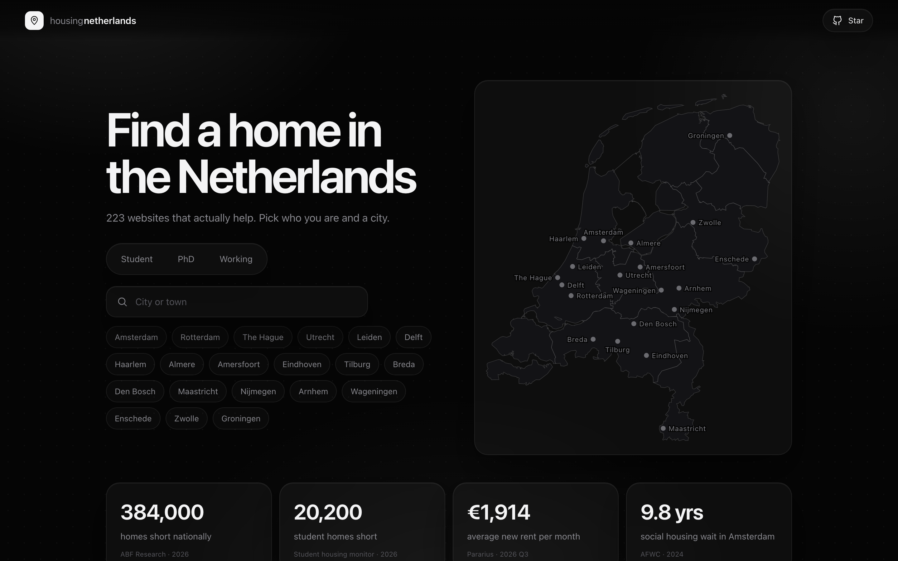

# housing-netherlands

**Every website that actually helps you find a home in the Netherlands.** 
Pick your city and whether you are a student, PhD or working. Get the right list.

### [→ kooroshkz.github.io/housing-netherlands](https://kooroshkz.github.io/housing-netherlands/)

## Why

Finding a room or apartment in the Netherlands means checking dozens of sites, each
with its own rules: waiting lists, lotteries, first come first served, students only,
no students, income checks. This project keeps one checked list, per city and per
person, so you know where to look and how each place works.

* **20 cities**: Amsterdam, Rotterdam, The Hague, Utrecht, Leiden, Delft, Eindhoven,
  Groningen, Nijmegen, Maastricht and more, with nearby towns.
* **Three roles**: student, PhD candidate, working professional or expat.
* **How you get in**: first come, lottery, waiting list, booking, fees, furnished.
* **Open data**: one JSON file anyone can fix. Free, no tracking, no ads.

Not affiliated with any website listed. Always book on the official site, and never pay
before you have seen the home and signed a contract.

## Contribute

Found a dead link, a new building, a better tip? [Open an issue](../../issues/new/choose)
or edit [`data/resources.json`](data/resources.json) (see [CONTRIBUTING.md](CONTRIBUTING.md)).
If this helped you, a ⭐ helps others find it.

<!-- list:start -->

## The list

223 websites, last checked 2026-11-02. Roles: 🎓 student · 🔬 PhD · 💼 working.

### Everywhere in the Netherlands

**Listing sites**

- [Directwonen](https://directwonen.nl/) 🔬💼 Paid tier sees listings 3 days earlier · Paid
- [Expatica Housing](https://www.expatica.com/nl/housing/) 🔬💼 English guides on renting and tenant rights
- [Facebook Marketplace and groups](https://www.facebook.com/marketplace/) 🎓🔬💼 Many rooms via groups; fake landlord scams are common · Free
- [Funda (rentals)](https://www.funda.nl/zoeken/huur) 🔬💼 Agency rentals; contacting the agent is free · Free
- [HousingAnywhere](https://housinganywhere.com/) 🎓🔬💼 Furnished mid-term rentals booked online · Free
- [Huurstunt](https://www.huurstunt.nl/) 🎓🔬💼 Aggregates 300+ sites; Premium needed to reply · Paid · €29.95/month (Premium)
- [Huurwoningen.nl](https://www.huurwoningen.nl/) 🎓🔬💼 Premium needed to contact many advertisers · Paid · €29.95/month (Premium)
- [IamExpat Housing](https://www.iamexpat.nl/housing/rental-properties) 🎓🔬💼 English rental listings aimed at internationals · Free
- [Kamer.nl](https://www.kamer.nl/en/) 🎓🔬 Premium needed to reply; cancel anytime · Paid · €29.95/month
- [Kamernet](https://kamernet.nl/en) 🎓🔬 Rooms and studios; Premium for unlimited replies · Paid
- [Marktplaats Huizen en Kamers](https://www.marktplaats.nl/l/huizen-en-kamers/) 🎓🔬💼 Private ads; high scam risk, never pay before viewing · Free
- [Pararius](https://www.pararius.com/english) 🎓🔬💼 Largest agency rental site; English; free to contact · Free

**Alerts**

- [HuisPing](https://huisping.nl/) 🎓🔬💼 Free daily digest; 3-month plan does not auto-renew · Free · Free; Plus €12.95/month or €29.95 per 3 months
- [Rentbird](https://rentbird.nl/en) 🎓🔬💼 Claims 1,400+ sites scanned; full refund promise · Paid · €29/month, or €16.33/month on 3-month plan
- [RentHunter](https://renthunter.nl/) 🎓🔬💼 Claims 1,100+ sites; prices not shown on homepage · Paid
- [Rentola](https://rentola.nl/) 🎓🔬💼 Warning: complaints of trials auto-renewing, hard to cancel · Paid · €39 to €39.99/month (per complaints)
- [RentSlam](https://rentslam.com/) 🎓🔬💼 Claims 1,500+ sites; switch off auto-renew yourself · Paid · €29.95/month, or €16.65/month on 3-month plan
- [Rentumo](https://rentumo.nl/) 🎓🔬💼 Warning: €4 trial rolls into €39.99/month · Paid · €39.99/month
- [Stekkies](https://www.stekkies.com/en/) 🎓🔬💼 Claims 1,000+ sites including social media · Paid · from €16.65/month
- [Uprent](https://uprent.nl/) 🎓🔬💼 Claims 234 platforms; price from a rival's comparison · Paid · €22.95/month
- [WoonBusters](https://www.woonbusters.nl/) 🎓🔬💼 Free search of 1,000+ sources; alerts are paid · Paid · from €3.99 per 2 weeks

**Rights & help**

- [Affordable Rent Act (Wet betaalbare huur)](https://www.volkshuisvestingnederland.nl/onderwerpen/huren-en-wonen/wet-betaalbare-huur) 🎓🔬💼 Since 1 Jul 2024 rent capped up to 186 points (mid-rent)
- [Agency fee ban (no double fees)](https://www.volkshuisvestingnederland.nl/onderwerpen/huren-en-wonen/wet-goed-verhuurderschap/voor-huurders) 🎓🔬💼 Only pay an agent you hired yourself
- [Deposit rule (Wet goed verhuurderschap)](https://www.volkshuisvestingnederland.nl/onderwerpen/huren-en-wonen/wet-goed-verhuurderschap/voor-huurders) 🎓🔬💼 Deposit max 2 months' basic rent (leases from Jul 2023)
- [Huurcommissie](https://www.huurcommissie.nl/) 🎓🔬💼 Official rent dispute body; can lower your rent
- [Huurcommissie rent check (points / WWS)](https://www.huurcommissie.nl/support/huurprijscheck) 🎓🔬💼 Check your legal max rent by points; also in English · Free
- [Huurtoeslag (rent benefit, Dienst Toeslagen)](https://www.belastingdienst.nl/wps/wcm/connect/nl/huurtoeslag/content/huurtoeslag-verandert-vanaf-2026) 🎓🔬💼 No rent cap from 2026; needs own home and BRP address · Free
- [Juridisch Loket](https://www.juridischloket.nl/) 🎓🔬💼 Free legal advice for low incomes; call 0800 80 20 · Free
- [Municipal landlord complaint point (meldpunt)](https://www.volkshuisvestingnederland.nl/onderwerpen/huren-en-wonen/wet-goed-verhuurderschap/voor-huurders) 🎓🔬💼 Every municipality must have a meldpunt for tenants · Free
- [Municipal registration (BRP) and BSN](https://www.government.nl/faq/when-should-i-register-with-the-personal-records-database-as-a-resident) 🎓🔬💼 Register within 5 days; no address means no BSN, no benefits
- [Permanent leases (Wet vaste huurcontracten)](https://www.volkshuisvestingnederland.nl/onderwerpen/huren-en-wonen/huurbescherming-en-huurcontracten/vaste-huurcontracten-de-norm) 🎓🔬💼 Since 1 Jul 2024 leases are permanent; students max 2 yrs
- [Woonbond](https://www.woonbond.nl/) 🎓🔬💼 Tenant union; member helpline 020-551 77 55

**Scam check**

- [Fraudehelpdesk: check before you rent](https://www.fraudehelpdesk.nl/campagnes/een-dak-boven-je-hoofd-of-van-je-centen-beroofd/) 🎓🔬💼 Rental scam red flags; report at 088-7867372 · Free
- [Police: report a scam](https://www.politie.nl/aangifte-of-melding-doen) 🎓🔬💼 File a report even for small losses; 0900-8844 · Free
- [Smart Checks (rental scam checklist)](https://www.thehagueinternationalcentre.nl/relocating/housing/smart-checks) 🎓🔬💼 Reverse-search photos, check owner and IBAN before paying

**Expat help**

- [LSVb Housing Hotline (with ESN)](https://lsvb.nl/diensten/housing-hotline/) 🎓 Students can ask about tenant rights via online form
- [Study in NL: finding a place to live](https://studyinnl.org/life-in-nl/finding-a-place-to-live) 🎓 Start early; never sign before seeing the room

**Letting agents**

- [123Wonen](https://www.123wonen.nl/) 💼 National agent; free email alerts

<b>Amsterdam</b> (48)

**Managed apartments**

- [Holland2Stay](https://www.holland2stay.com/residences) 🎓🔬💼 Book directly, or the Tuesday 17:00 lottery · First come · €1,100–2,500
- [Roofz · The Cohesion](https://roofz.eu/huur/woningen) 🎓🔬💼 Young-professional buildings, first come · First come · €1,300–1,700
- [Our Domain](https://www.thisisourdomain.nl/book-now) 🎓🔬💼 Big Greystar buildings in Diemen and Zuidoost · Book online · €1,040–2,140 + service

**Student housing**

- [Canvas Diemen (ex OurCampus)](https://www.canvas-world.com/en/locations/netherlands/amsterdam/diemen) 🎓 Student studios in Diemen, now part of Canvas · Book online
- [De Key Short Stay](https://dekeyshortstay.guestcompass.nl/de-key-student-accommodation) 🎓 Only via partner schools (UvA, HvA, AHK); no extension · Via university
- [DUWO](https://www.duwo.nl/en/) 🎓 Register at ROOM.nl; ranked by registration time · Waitlist
- [Student Experience (Amstel, NDSM, Zuidas, Leiden)](https://studentexperience.com/studios) 🎓 Students only; unfurnished studios, minimum 12 months · Book online · €674–840 plus €160 service
- [The Social Hub student stay](https://www.thesocialhub.co/) 🎓 All-inclusive hotel-style rooms for 5–12 months · Book online · €1,000–1,450
- [VoorUit](https://www.vooruitproject.nl/vooruiter-worden) 🎓 Pay no rent for about 10 hours a week of volunteering · Service costs only
- [Xior Student Housing](https://www.xior-booking.com/) 🎓 Online booking; PhD rules not published, ask Xior · Book online · €400–1,140

**University housing**

- [Amsterdam research institutes (NIKHEF, AMOLF, IISG) via DUWO](https://www.duwo.nl/en/i-search/duwo-university-housing/1/duwo-university-housing-location-amsterdam/national-institute-for-subatomic-physics-nikhef) 🔬💼 Institutes reserve DUWO flats for international guests · Via university
- [HvA / AUAS student housing](https://www.amsterdamuas.com/study/international-admissions/housing/apply-for-housing-bachelor-master) 🎓 Invite comes end of May; lottery, only one offer · Lottery · €370–1,150
- [Inholland student housing](https://www.inholland.nl/inhollandcom/student-life-and-housing/student-housing/haarlem/degree-students) 🎓 Haarlem Feb 2027 round opens 15 Nov 2026, 09:00 · First come · €413–623 (Haarlem)
- [UvA International Student Housing](https://student.uva.nl/en/information/step-4-uva-student-housing-limited-availability) 🎓 Spring 2027: apply by 9 Nov 2026; about half get a room · Lottery · €370–1,150
- [UvA staff and PhD housing](https://werkenbij.uva.nl/en/accommodation-types-and-rent) 🔬💼 Short stay max 6 months; long stay is rare, PhD only · Via university · €450–2,000
- [VU Amsterdam PhD housing](https://vu.nl/en/research/more-about/accommodation-for-phd-students) 🔬 Furnished studio, max 6 months; only ~50% of PhDs housed · Via university
- [VU Amsterdam student housing](https://vu.nl/en/education/more-about/looking-for-accommodation-in-amsterdam) 🎓 First-year internationals; first paid, first served · First come · €560–1,300

**Landlords**

- [Vesteda](https://www.vesteda.com/nl/consument/aanbod-bekijken) 🔬💼 Free sign-up; scored, lottery on ties · Scored · €930–2,000+
- [ikwilhuren.nu (MVGM)](https://ikwilhuren.nu/) 🔬💼 Biggest volume; lottery within 48 hours · Lottery · median ~€1,500
- [Eigen Haard mid-rent and free sector](https://www.eigenhaard.nl/te-huur/vrije-sector-huur/zoek/) 💼 Apply via Mijn Dak; single income from €51,538 · from €933
- [Heimstaden](https://heimstaden.com/nl/huurwoningen/) 💼 Few listings; 5–20 people per viewing · €675–1,735
- [LIV Residential](https://livresidential.nl/huurwoningen) 🔬💼 Investor-owned free-sector homes
- [Mijn Dak Amsterdam mid-rent and free sector](https://amsterdam.mijndak.nl/) 🔬💼 Free account; landlord rules, max 4 replies at once · €933–1,228 (mid-rent)
- [Wooove](https://hurenbijwooove.nl/MenuID/85731/Woning/Verhuur/) 🔬💼 Fill in a 'woonwens' to be emailed first · First come · €900–2,200

**Letting agents**

- [vb&t](https://vbtverhuurmakelaars.nl/woningen) 🔬💼 Register early: time registered can count · Scored
- [Brockhoff](https://www.brockhoff.nl/) 💼 Amstelveen, Diemen, Amsterdam new builds · avg ~€1,700
- [Interhouse](https://interhouse.nl/) 💼 Expat agent; first come plus criteria · First come · median ~€2,350
- [Rebo](https://www.rebogroep.nl/) 💼 High volume in Utrecht and Amsterdam
- [Rotsvast](https://www.rotsvast.nl/) 🔬💼 Large national agent; 3x income for expats
- [Uppmärk](https://www.uppmark.nl/aanbod?type=Huur) 🔬💼 Lets many new towers; register per project · €1,100–2,800

**Co-living**

- [Change=](https://www.change-is.com/nl/huurwoningen-in-utrecht) 💼 Working people about 20–36; intake and waitlist · Waitlist · from €644 + service
- [Dam & Hague Coliving](https://damcoliving.nl/) 🔬💼 Shared furnished apartments for professionals · €775–1,030 per room
- [Plaza Resident Services (NewNewNew)](https://plaza.newnewnew.space/en/) 🎓🔬💼 Reply in first 10 minutes to enter the lottery; no waitlist · Lottery

**New builds**

- [Amsterdam Woont](https://www.amsterdamwoont.nl/) 🎓🔬💼 Amsterdam's own housing overview
- [Nieuwbouw-in sites](https://www.nieuwbouw-in-amsterdam.nl/) 🔬💼 New-build rentals per city; register early

**Short stay**

- [Corporate Housing Factory](https://www.corporatehousingfactory.com/) 🔬💼 Serviced apartments for 3 to 12 months · Book online
- [DUWO Direct Offer](https://www.duwo.nl/en/i-search/other-offers/direct-offer) 🎓🔬 Temporary furnished room, 15 days to 1 year; PhDs allowed · Book online · €350–500
- [Stayokay Student Stay](https://stayokay.com/en/student-stay) 🎓 Hostel bed by the week while you search; proof of study · Book online · €1,134 per 4 weeks (dorm)
- [Student Experience Minervahaven](https://studentexperience.com/studios-minervahaven) 🎓🔬 Internationals only, max 1 year; PhD research allowed · Book online · €1,550–2,099
- [The Social Hub extended stay](https://www.thesocialhub.co/rotterdam/extended-stay/) 🎓🔬💼 Hotel room by the month, from 2 weeks; open to anyone · Book online

**Social & mid-rent**

- [Mijn Dak Amsterdam (WoningNet regio Amsterdam)](https://amsterdam.mijndak.nl/) 🎓🔬💼 Points: 1 per year registered plus search points · Scored · up to €933

**Listing sites**

- [DAK Studentenwoning (Studentenwoningweb)](https://studentenwoning.mijndak.nl/) 🎓 Corporation rooms in Amsterdam and Diemen; from age 16 · Waitlist
- [Facebook: Amsterdam housing and roommates](https://www.facebook.com/groups/amsterdam.housing.and.roommates/) 🎓🔬💼 Many scams; see the room before paying anything · First come
- [Hospi Housing](https://www.hospihousing.com/gb/) 🎓🔬💼 Rent a room in a verified local host's home
- [ROOM.nl](https://www.room.nl/en/) 🎓 One sign-up for DUWO, SSH, Ymere, Pré Wonen; from age 16 · Waitlist

**Expat help**

- [IN Amsterdam](https://www.iamsterdam.com/en/live-work-study/in-amsterdam) 🔬💼 Permits and BSN for newcomers; free helpdesk · Free

**Rights & help**

- [!WOON](https://www.wooninfo.nl/) 🎓🔬💼 Amsterdam tenant advice; English scam and deposit guides
- [Hospiteren (house viewing nights)](https://dub.uu.nl/en/depth/all-ways-you-can-find-room-utrecht) 🎓 Housemates pick the new tenant after a viewing evening

<b>Rotterdam</b> (40)

**Managed apartments**

- [Holland2Stay](https://www.holland2stay.com/residences) 🎓🔬💼 Book directly, or the Tuesday 17:00 lottery · First come · €1,100–2,500
- [Roofz · The Cohesion](https://roofz.eu/huur/woningen) 🎓🔬💼 Young-professional buildings, first come · First come · €1,300–1,700
- [Canvas Brainpark](https://www.canvas-world.com/en/locations/netherlands/rotterdam/brainpark) 🔬💼 Furnished studios for starters and PhDs · Book online · €1,270–1,350

**Student housing**

- [Homey Housing](https://homeyhousing.com/?lang=en) 🎓 Furnished shared flats and studios · Book online · €450–775 and up
- [International Student Housing Rotterdam (ISHR)](https://ishr.nl) 🎓 Furnished flatshares; EUR first-years book in early May · First come · €650–950
- [RoomPlaza](https://www.roomplaza.com/) 🎓 Book a whole furnished flat as a group · First come · €500–900
- [SSH Long Stay](https://www.sshxl.nl/en) 🎓 Utrecht wait is about 40–46 months; register early · Waitlist
- [Stadswonen Rotterdam](https://www.stadswonenrotterdam.nl/en/how-it-works/Register) 🎓 Ages 16–27, study in Rotterdam; wait about 10–15 months · Waitlist · from €325
- [Student Housing Willemskade](https://www.eur.nl/en/education/practical-matters/orientation-arrival/housing/reserved-accommodation/student-housing-willemskade-rotterdam) 🎓 EUR first-years only, booking voucher sent in May · Via university · €650–1,000
- [The Social Hub student stay](https://www.thesocialhub.co/) 🎓 All-inclusive hotel-style rooms for 5–12 months · Book online · €1,000–1,450
- [Xior Student Housing](https://www.xior-booking.com/) 🎓 Online booking; PhD rules not published, ask Xior · Book online · €400–1,140

**University housing**

- [Erasmus MC Graduate School rooms (RoomPlaza)](https://www.eur.nl/en/erasmusmc/graduate-school/practical-matters/international-office) 🎓🔬 For Erasmus MC PhDs in year one and Research Master students · Via university
- [Erasmus University reserved accommodation](https://www.eur.nl/en/education/practical-matters/orientation-arrival/housing/reserved-accommodation) 🎓 About 1,200 rooms for 25% of new internationals; age 30 max · First come · €600–1,140
- [Rotterdam UAS (Hogeschool Rotterdam) SSH rooms](https://rotterdamuas.com/study-information/practical-information/Student-Housing/ssh-short-stay-accommodations/) 🎓 Spring 2027: register 18–25 Nov, booking opens 25 Nov · First come · €650–800

**Landlords**

- [Vesteda](https://www.vesteda.com/nl/consument/aanbod-bekijken) 🔬💼 Free sign-up; scored, lottery on ties · Scored · €930–2,000+
- [ikwilhuren.nu (MVGM)](https://ikwilhuren.nu/) 🔬💼 Biggest volume; lottery within 48 hours · Lottery · median ~€1,500
- [Havensteder mid-rent and free sector](https://www.havensteder.nl/te-huur-en-te-koop) 💼 Lists its own mid-rent and free-sector homes
- [LIV Residential](https://livresidential.nl/huurwoningen) 🔬💼 Investor-owned free-sector homes
- [Nationaal Grondbezit](https://www.nationaalgrondbezit.nl/) 💼 Private landlord with homes in Rotterdam, The Hague · median ~€1,400
- [Woonnet Rijnmond mid-rent and free sector](https://www.woonnetrijnmond.nl/) 🔬💼 Landlord picks tenant for free-sector homes
- [Woonstad free sector](https://www.woonstadrotterdam.nl/aanbod/vrije-sector-huurwoning) 🔬💼 Corporation free sector, no agency fee
- [Wooove](https://hurenbijwooove.nl/MenuID/85731/Woning/Verhuur/) 🔬💼 Fill in a 'woonwens' to be emailed first · First come · €900–2,200

**Letting agents**

- [vb&t](https://vbtverhuurmakelaars.nl/woningen) 🔬💼 Register early: time registered can count · Scored
- [Interhouse](https://interhouse.nl/) 💼 Expat agent; first come plus criteria · First come · median ~€2,350
- [Rotsvast](https://www.rotsvast.nl/) 🔬💼 Large national agent; 3x income for expats
- [Uppmärk](https://www.uppmark.nl/aanbod?type=Huur) 🔬💼 Lets many new towers; register per project · €1,100–2,800
- [Verra](https://www.verra.nl/) 💼 Big in The Hague; lets new towers
- [Woonzeker](https://woonzeker.com/) 💼 Many listings in The Hague and Rotterdam · median ~€1,100

**New builds**

- [Nieuwbouw-in sites](https://www.nieuwbouw-in-amsterdam.nl/) 🔬💼 New-build rentals per city; register early
- [Wonen in Rotterdam](https://www.woneninrotterdam.nl/) 🔬💼 City news on new rental towers

**Short stay**

- [Corporate Housing Factory](https://www.corporatehousingfactory.com/) 🔬💼 Serviced apartments for 3 to 12 months · Book online
- [Room to Rent](https://www.room-to-rent.nl/en_GB/) 🎓 Furnished short-stay rooms around Delft and The Hague · Book online
- [SSH Short Stay](https://www.sshxl.nl/en/rental-offer/short-stay) 🎓🔬 Your university must approve you before you can book · Via university · €650–1,000
- [The Social Hub extended stay](https://www.thesocialhub.co/rotterdam/extended-stay/) 🎓🔬💼 Hotel room by the month, from 2 weeks; open to anyone · Book online

**Social & mid-rent**

- [Woonnet Rijnmond](https://www.woonnetrijnmond.nl/) 🎓🔬💼 Registration time, lottery or first-come per listing · Waitlist · up to €933

**Listing sites**

- [Facebook: Kamer in Rotterdam](https://www.facebook.com/groups/kamer.in.rotterdam/) 🎓🔬💼 Room ads from housemates; check the poster's profile · First come
- [Hospi Housing](https://www.hospihousing.com/gb/) 🎓🔬💼 Rent a room in a verified local host's home
- [ROOM.nl](https://www.room.nl/en/) 🎓 One sign-up for DUWO, SSH, Ymere, Pré Wonen; from age 16 · Waitlist

**Expat help**

- [Rotterdam International Center](https://www.rotterdam.info/en/internationals/how-we-help) 🔬💼 BSN, permits, housing advice; eligible groups only

**Rights & help**

- [Hospiteren (house viewing nights)](https://dub.uu.nl/en/depth/all-ways-you-can-find-room-utrecht) 🎓 Housemates pick the new tenant after a viewing evening

<b>The Hague</b> (42)

**Managed apartments**

- [Holland2Stay](https://www.holland2stay.com/residences) 🎓🔬💼 Book directly, or the Tuesday 17:00 lottery · First come · €1,100–2,500
- [Momento](https://www.momentoliving.com/nl/locations/netherlands/rijswijk) 🔬💼 Greystar in Rijswijk; live availability, no fees · Book online · €1,230–1,975
- [Magis Real Estate](https://magisrealestate.com/for-rent) 🔬💼 Rijswijk, Den Bosch, Amersfoort; lottery · Lottery · €190–1,990

**Student housing**

- [DUWO](https://www.duwo.nl/en/) 🎓 Register at ROOM.nl; ranked by registration time · Waitlist
- [Homey Housing](https://homeyhousing.com/?lang=en) 🎓 Furnished shared flats and studios · Book online · €450–775 and up
- [RoomPlaza](https://www.roomplaza.com/) 🎓 Book a whole furnished flat as a group · First come · €500–900
- [The Social Hub student stay](https://www.thesocialhub.co/) 🎓 All-inclusive hotel-style rooms for 5–12 months · Book online · €1,000–1,450
- [Xior Student Housing](https://www.xior-booking.com/) 🎓 Online booking; PhD rules not published, ask Xior · Book online · €400–1,140

**University housing**

- [Inholland student housing](https://www.inholland.nl/inhollandcom/student-life-and-housing/student-housing/haarlem/degree-students) 🎓 Haarlem Feb 2027 round opens 15 Nov 2026, 09:00 · First come · €413–623 (Haarlem)
- [Leiden University Housing Office](https://universiteitleiden.nl/en/education/international-students/prepare-your-stay/housing/via-leiden-university-housing-office) 🎓 Spring 2027 full for degree students; exchange still open · First come · €425–1,200
- [Leiden University SCIS housing (PhD and staff)](https://scishousing.universiteitleiden.nl/) 🔬💼 PhDs get long stay; longest registration goes first · Waitlist · €1,000–1,350
- [The Hague University (THUAS) Housing Service](https://www.thuas.com/study-choice/international-office/housing) 🎓 No guarantee; you may get a different provider · Via university · €450–1,135

**Landlords**

- [Vesteda](https://www.vesteda.com/nl/consument/aanbod-bekijken) 🔬💼 Free sign-up; scored, lottery on ties · Scored · €930–2,000+
- [ikwilhuren.nu (MVGM)](https://ikwilhuren.nu/) 🔬💼 Biggest volume; lottery within 48 hours · Lottery · median ~€1,500
- [Corpowonen (Staedion)](https://www.corpowonen.nl/) 🔬💼 Corporation free-sector homes; email alerts · Lottery · from €933
- [Heimstaden](https://heimstaden.com/nl/huurwoningen/) 💼 Few listings; 5–20 people per viewing · €675–1,735
- [LIV Residential](https://livresidential.nl/huurwoningen) 🔬💼 Investor-owned free-sector homes
- [Nationaal Grondbezit](https://www.nationaalgrondbezit.nl/) 💼 Private landlord with homes in Rotterdam, The Hague · median ~€1,400
- [Staedion free sector](https://www.staedion.nl/ik-zoek/een-vrijesectorwoning) 💼 Free-sector homes by lottery on CORPOwonen · Lottery · from €1,228
- [Woonnet Haaglanden mid-rent](https://www.woonnet-haaglanden.nl/) 🔬💼 Den Haag mid-rent income cap €70,149 single · €933–1,228
- [Wooove](https://hurenbijwooove.nl/MenuID/85731/Woning/Verhuur/) 🔬💼 Fill in a 'woonwens' to be emailed first · First come · €900–2,200

**Letting agents**

- [vb&t](https://vbtverhuurmakelaars.nl/woningen) 🔬💼 Register early: time registered can count · Scored
- [Interhouse](https://interhouse.nl/) 💼 Expat agent; first come plus criteria · First come · median ~€2,350
- [Rotsvast](https://www.rotsvast.nl/) 🔬💼 Large national agent; 3x income for expats
- [Uppmärk](https://www.uppmark.nl/aanbod?type=Huur) 🔬💼 Lets many new towers; register per project · €1,100–2,800
- [Verra](https://www.verra.nl/) 💼 Big in The Hague; lets new towers
- [Woonzeker](https://woonzeker.com/) 💼 Many listings in The Hague and Rotterdam · median ~€1,100

**Co-living**

- [Dam & Hague Coliving](https://damcoliving.nl/) 🔬💼 Shared furnished apartments for professionals · €775–1,030 per room
- [Plaza Resident Services (NewNewNew)](https://plaza.newnewnew.space/en/) 🎓🔬💼 Reply in first 10 minutes to enter the lottery; no waitlist · Lottery

**New builds**

- [Wonen in Den Haag](https://wonenindenhaag.nl/nieuwbouw/) 🔬💼 Every new-build project in The Hague

**Short stay**

- [Corporate Housing Factory](https://www.corporatehousingfactory.com/) 🔬💼 Serviced apartments for 3 to 12 months · Book online
- [DUWO Direct Offer](https://www.duwo.nl/en/i-search/other-offers/direct-offer) 🎓🔬 Temporary furnished room, 15 days to 1 year; PhDs allowed · Book online · €350–500
- [Room to Rent](https://www.room-to-rent.nl/en_GB/) 🎓 Furnished short-stay rooms around Delft and The Hague · Book online
- [Student Housing The Hague](https://www.studenthousingthehague.com/) 🎓 Furnished short-stay rooms for international students · Book online
- [The Social Hub extended stay](https://www.thesocialhub.co/rotterdam/extended-stay/) 🎓🔬💼 Hotel room by the month, from 2 weeks; open to anyone · Book online

**Social & mid-rent**

- [Woonnet Haaglanden](https://www.woonnet-haaglanden.nl/) 🎓🔬💼 Registration time; some lottery and first-come homes · Waitlist · up to €933

**Listing sites**

- [Facebook: Find a room(mate) in The Hague](https://www.facebook.com/groups/kamer.in.denhaag/) 🎓🔬💼 30,000+ members; never pay or send ID before a viewing · First come
- [Hospi Housing](https://www.hospihousing.com/gb/) 🎓🔬💼 Rent a room in a verified local host's home
- [ROOM.nl](https://www.room.nl/en/) 🎓 One sign-up for DUWO, SSH, Ymere, Pré Wonen; from age 16 · Waitlist

**Expat help**

- [The Hague International Centre](https://www.thehagueinternationalcentre.nl/) 🎓🔬💼 Newcomer hub with housing guides and scam checks

**Rights & help**

- [Hospiteren (house viewing nights)](https://dub.uu.nl/en/depth/all-ways-you-can-find-room-utrecht) 🎓 Housemates pick the new tenant after a viewing evening
- [Huurteam Den Haag (Fair Rent Team)](https://www.denhaag.nl/en/housing/ask-for-advice-from-the-fair-rent-team/) 🎓🔬💼 Free rent check for private tenants; call 14070 · Free

<b>Utrecht</b> (29)

**Managed apartments**

- [Holland2Stay](https://www.holland2stay.com/residences) 🎓🔬💼 Book directly, or the Tuesday 17:00 lottery · First come · €1,100–2,500

**Student housing**

- [SSH Long Stay](https://www.sshxl.nl/en) 🎓 Utrecht wait is about 40–46 months; register early · Waitlist
- [THE FIZZ Utrecht](https://www.the-fizz.com/en/student-accommodation/utrecht/) 🎓🔬 Campus contract for enrolled students and PhD candidates · Book online · €498–933 plus about €250 fees
- [Xior Student Housing](https://www.xior-booking.com/) 🎓 Online booking; PhD rules not published, ask Xior · Book online · €400–1,140

**University housing**

- [HU (Hogeschool Utrecht) reserved housing](https://www.internationalhu.com/reserved-housing) 🎓 Exchange and non-EEA first-years; SSH or Xior rooms · First come · €348–991
- [Utrecht University PhD and staff housing (SSH Short Stay)](https://www.uu.nl/en/organisation/international-staff-and-guests/prepare-for-your-stay/finding-housing/reserved-accommodation-programme/reserved-housing-for-international-phds) 🔬💼 Register with SSH up to 4 months before arrival · Via university · €750–1,000
- [Utrecht University reserved accommodation](https://www.uu.nl/en/education/exchange-students/arriving-and-living/housing/ways-to-find-housing/uu-reserved-accommodation-programme/reserved-accommodation-february-2027) 🎓 Via SSH, Xior, Plaza; Sept rooms sold out on day one · €440–1,008

**Landlords**

- [Vesteda](https://www.vesteda.com/nl/consument/aanbod-bekijken) 🔬💼 Free sign-up; scored, lottery on ties · Scored · €930–2,000+
- [ikwilhuren.nu (MVGM)](https://ikwilhuren.nu/) 🔬💼 Biggest volume; lottery within 48 hours · Lottery · median ~€1,500
- [LIV Residential](https://livresidential.nl/huurwoningen) 🔬💼 Investor-owned free-sector homes
- [Mijn Dak Utrecht mid-rent and free sector](https://utrecht.mijndak.nl/) 🔬💼 Free account; social renters get priority · €933–1,228 (mid-rent)
- [Portaal free sector](https://www.portaal.nl/ik-zoek/vrije-sector-huurwoning/vrije-sector-huurwoning/) 💼 Free-sector homes; income check per home · from €933
- [Wooove](https://hurenbijwooove.nl/MenuID/85731/Woning/Verhuur/) 🔬💼 Fill in a 'woonwens' to be emailed first · First come · €900–2,200

**Letting agents**

- [vb&t](https://vbtverhuurmakelaars.nl/woningen) 🔬💼 Register early: time registered can count · Scored
- [Interhouse](https://interhouse.nl/) 💼 Expat agent; first come plus criteria · First come · median ~€2,350
- [Rebo](https://www.rebogroep.nl/) 💼 High volume in Utrecht and Amsterdam
- [Rotsvast](https://www.rotsvast.nl/) 🔬💼 Large national agent; 3x income for expats

**Co-living**

- [Change=](https://www.change-is.com/nl/huurwoningen-in-utrecht) 💼 Working people about 20–36; intake and waitlist · Waitlist · from €644 + service
- [Plaza Resident Services (NewNewNew)](https://plaza.newnewnew.space/en/) 🎓🔬💼 Reply in first 10 minutes to enter the lottery; no waitlist · Lottery

**New builds**

- [Nieuwbouw-in sites](https://www.nieuwbouw-in-amsterdam.nl/) 🔬💼 New-build rentals per city; register early

**Short stay**

- [SSH Short Stay](https://www.sshxl.nl/en/rental-offer/short-stay) 🎓🔬 Your university must approve you before you can book · Via university · €650–1,000
- [Stayokay Student Stay](https://stayokay.com/en/student-stay) 🎓 Hostel bed by the week while you search; proof of study · Book online · €1,134 per 4 weeks (dorm)

**Social & mid-rent**

- [Mijn Dak Utrecht (WoningNet regio Utrecht)](https://utrecht.mijndak.nl/) 🎓🔬💼 Ranked by registration time; DigiD check optional · Waitlist · up to €933

**Listing sites**

- [Facebook: Expats Utrecht](https://www.facebook.com/groups/expatsutrecht) 🎓🔬💼 Room posts appear; many Dutch ads say no internationals · First come
- [Hospi Housing](https://www.hospihousing.com/gb/) 🎓🔬💼 Rent a room in a verified local host's home
- [ROOM.nl](https://www.room.nl/en/) 🎓 One sign-up for DUWO, SSH, Ymere, Pré Wonen; from age 16 · Waitlist

**Expat help**

- [Utrecht International Center](https://utrechtinternationalcenter.com/) 🎓🔬💼 Permits, registration and housing info for Utrecht region

**Rights & help**

- [Hospiteren (house viewing nights)](https://dub.uu.nl/en/depth/all-ways-you-can-find-room-utrecht) 🎓 Housemates pick the new tenant after a viewing evening
- [Huurteam Utrecht](https://huurteam-utrecht.nl/) 🎓🔬💼 City-funded rent checks; won €557,818 back in 2024 · Free

<b>Leiden</b> (21)

**Managed apartments**

- [Holland2Stay](https://www.holland2stay.com/residences) 🎓🔬💼 Book directly, or the Tuesday 17:00 lottery · First come · €1,100–2,500

**Student housing**

- [DUWO](https://www.duwo.nl/en/) 🎓 Register at ROOM.nl; ranked by registration time · Waitlist
- [Student Experience (Amstel, NDSM, Zuidas, Leiden)](https://studentexperience.com/studios) 🎓 Students only; unfurnished studios, minimum 12 months · Book online · €674–840 plus €160 service
- [THE FIZZ Leiden](https://www.the-fizz.com/en/student-accommodation/leiden/) 🎓🔬💼 Short stay (4–6 months) also open with proof of income · Book online · €905–1,596
- [Xior Student Housing](https://www.xior-booking.com/) 🎓 Online booking; PhD rules not published, ask Xior · Book online · €400–1,140

**University housing**

- [Leiden UAS (Hogeschool Leiden)](https://www.hsleiden.nl/en/exchange/practical-information) 🎓 Few DUWO rooms; 20% off HousingAnywhere via the school · Via university
- [Leiden University Housing Office](https://universiteitleiden.nl/en/education/international-students/prepare-your-stay/housing/via-leiden-university-housing-office) 🎓 Spring 2027 full for degree students; exchange still open · First come · €425–1,200
- [Leiden University SCIS housing (PhD and staff)](https://scishousing.universiteitleiden.nl/) 🔬💼 PhDs get long stay; longest registration goes first · Waitlist · €1,000–1,350

**Landlords**

- [Vesteda](https://www.vesteda.com/nl/consument/aanbod-bekijken) 🔬💼 Free sign-up; scored, lottery on ties · Scored · €930–2,000+
- [ikwilhuren.nu (MVGM)](https://ikwilhuren.nu/) 🔬💼 Biggest volume; lottery within 48 hours · Lottery · median ~€1,500
- [Portaal free sector](https://www.portaal.nl/ik-zoek/vrije-sector-huurwoning/vrije-sector-huurwoning/) 💼 Free-sector homes; income check per home · from €933

**Letting agents**

- [Rotsvast](https://www.rotsvast.nl/) 🔬💼 Large national agent; 3x income for expats

**New builds**

- [Nieuwbouw-in sites](https://www.nieuwbouw-in-amsterdam.nl/) 🔬💼 New-build rentals per city; register early

**Short stay**

- [DUWO Direct Offer](https://www.duwo.nl/en/i-search/other-offers/direct-offer) 🎓🔬 Temporary furnished room, 15 days to 1 year; PhDs allowed · Book online · €350–500

**Social & mid-rent**

- [Huren in Holland Rijnland](https://www.hureninhollandrijnland.nl/) 🎓🔬💼 Ranked by registration time; about 5% by lottery · Waitlist · up to €933

**Listing sites**

- [Facebook: Leiden Housing](https://www.facebook.com/groups/leiden.housing/) 🎓🔬💼 Post a wanted ad or find a housemate · First come
- [Hospi Housing](https://www.hospihousing.com/gb/) 🎓🔬💼 Rent a room in a verified local host's home
- [ROOM.nl](https://www.room.nl/en/) 🎓 One sign-up for DUWO, SSH, Ymere, Pré Wonen; from age 16 · Waitlist

**Expat help**

- [Leiden International Centre](https://www.leideninternationalcentre.nl/) 🎓🔬💼 Free helpdesk, BSN appointments, housing consultations · Free

**Rights & help**

- [Hospiteren (house viewing nights)](https://dub.uu.nl/en/depth/all-ways-you-can-find-room-utrecht) 🎓 Housemates pick the new tenant after a viewing evening
- [Huurteam Leiden](https://huurteamleiden.nl/) 🎓🔬💼 Free help with high rent, repairs and landlord issues · Free

<b>Delft</b> (19)

**Managed apartments**

- [Holland2Stay](https://www.holland2stay.com/residences) 🎓🔬💼 Book directly, or the Tuesday 17:00 lottery · First come · €1,100–2,500

**Student housing**

- [DUWO](https://www.duwo.nl/en/) 🎓 Register at ROOM.nl; ranked by registration time · Waitlist
- [Homey Housing](https://homeyhousing.com/?lang=en) 🎓 Furnished shared flats and studios · Book online · €450–775 and up
- [International Student Housing Rotterdam (ISHR)](https://ishr.nl) 🎓 Furnished flatshares; EUR first-years book in early May · First come · €650–950
- [RoomPlaza](https://www.roomplaza.com/) 🎓 Book a whole furnished flat as a group · First come · €500–900
- [The Social Hub student stay](https://www.thesocialhub.co/) 🎓 All-inclusive hotel-style rooms for 5–12 months · Book online · €1,000–1,450
- [Xior Student Housing](https://www.xior-booking.com/) 🎓 Online booking; PhD rules not published, ask Xior · Book online · €400–1,140

**University housing**

- [Inholland student housing](https://www.inholland.nl/inhollandcom/student-life-and-housing/student-housing/haarlem/degree-students) 🎓 Haarlem Feb 2027 round opens 15 Nov 2026, 09:00 · First come · €413–623 (Haarlem)
- [TU Delft Housing Service](https://www.duwo.nl/en/i-search/duwo-university-housing/1/duwo-university-housing-location-delft/translate-to-engels-technische-universiteit-delft/master-bachelor-and-exchange-students-of-tu-delft) 🎓 Under 45% get a room; queue set by fee payment date · First come
- [TU Delft PhD and guest housing (DUWO)](https://www.duwo.nl/en/i-search/duwo-university-housing/1/duwo-university-housing-location-delft/translate-to-engels-technische-universiteit-delft/phd-students-tu-delft) 🔬💼 DUWO room for 1–6 months while you search · Via university

**Landlords**

- [ikwilhuren.nu (MVGM)](https://ikwilhuren.nu/) 🔬💼 Biggest volume; lottery within 48 hours · Lottery · median ~€1,500

**Co-living**

- [Plaza Resident Services (NewNewNew)](https://plaza.newnewnew.space/en/) 🎓🔬💼 Reply in first 10 minutes to enter the lottery; no waitlist · Lottery

**New builds**

- [Nieuwbouw-in sites](https://www.nieuwbouw-in-amsterdam.nl/) 🔬💼 New-build rentals per city; register early

**Short stay**

- [DUWO Direct Offer](https://www.duwo.nl/en/i-search/other-offers/direct-offer) 🎓🔬 Temporary furnished room, 15 days to 1 year; PhDs allowed · Book online · €350–500
- [Room to Rent](https://www.room-to-rent.nl/en_GB/) 🎓 Furnished short-stay rooms around Delft and The Hague · Book online

**Social & mid-rent**

- [Woonnet Haaglanden](https://www.woonnet-haaglanden.nl/) 🎓🔬💼 Registration time; some lottery and first-come homes · Waitlist · up to €933

**Listing sites**

- [Hospi Housing](https://www.hospihousing.com/gb/) 🎓🔬💼 Rent a room in a verified local host's home
- [ROOM.nl](https://www.room.nl/en/) 🎓 One sign-up for DUWO, SSH, Ymere, Pré Wonen; from age 16 · Waitlist

**Rights & help**

- [Hospiteren (house viewing nights)](https://dub.uu.nl/en/depth/all-ways-you-can-find-room-utrecht) 🎓 Housemates pick the new tenant after a viewing evening

<b>Haarlem</b> (10)

**Managed apartments**

- [Holland2Stay](https://www.holland2stay.com/residences) 🎓🔬💼 Book directly, or the Tuesday 17:00 lottery · First come · €1,100–2,500

**Student housing**

- [DUWO](https://www.duwo.nl/en/) 🎓 Register at ROOM.nl; ranked by registration time · Waitlist

**University housing**

- [Inholland student housing](https://www.inholland.nl/inhollandcom/student-life-and-housing/student-housing/haarlem/degree-students) 🎓 Haarlem Feb 2027 round opens 15 Nov 2026, 09:00 · First come · €413–623 (Haarlem)

**Landlords**

- [ikwilhuren.nu (MVGM)](https://ikwilhuren.nu/) 🔬💼 Biggest volume; lottery within 48 hours · Lottery · median ~€1,500
- [Wooove](https://hurenbijwooove.nl/MenuID/85731/Woning/Verhuur/) 🔬💼 Fill in a 'woonwens' to be emailed first · First come · €900–2,200

**New builds**

- [Nieuwbouw-in sites](https://www.nieuwbouw-in-amsterdam.nl/) 🔬💼 New-build rentals per city; register early

**Social & mid-rent**

- [Mijn Woonservice (Zuid-Kennemerland and IJmond)](https://mijnwoonservice.mijndak.nl/) 🎓🔬💼 Haarlem area; ranked by registration time · Waitlist · up to €933

**Listing sites**

- [ROOM.nl](https://www.room.nl/en/) 🎓 One sign-up for DUWO, SSH, Ymere, Pré Wonen; from age 16 · Waitlist

**Rights & help**

- [!WOON](https://www.wooninfo.nl/) 🎓🔬💼 Amsterdam tenant advice; English scam and deposit guides
- [Hospiteren (house viewing nights)](https://dub.uu.nl/en/depth/all-ways-you-can-find-room-utrecht) 🎓 Housemates pick the new tenant after a viewing evening

<b>Almere</b> (9)

**Managed apartments**

- [Roofz · The Cohesion](https://roofz.eu/huur/woningen) 🎓🔬💼 Young-professional buildings, first come · First come · €1,300–1,700

**Landlords**

- [Vesteda](https://www.vesteda.com/nl/consument/aanbod-bekijken) 🔬💼 Free sign-up; scored, lottery on ties · Scored · €930–2,000+
- [ikwilhuren.nu (MVGM)](https://ikwilhuren.nu/) 🔬💼 Biggest volume; lottery within 48 hours · Lottery · median ~€1,500
- [Amvest](https://amvest.nl/voor-huurders/) 🔬💼 Let via local agents; income 3.5 to 4x rent; draw · Lottery
- [Heimstaden](https://heimstaden.com/nl/huurwoningen/) 💼 Few listings; 5–20 people per viewing · €675–1,735

**Letting agents**

- [Interhouse](https://interhouse.nl/) 💼 Expat agent; first come plus criteria · First come · median ~€2,350
- [Xpat Housing Solutions](https://xpathousingsolutions.nl/rental-solutions/) 🔬💼 Paid search service from Eindhoven, works nationwide

**Social & mid-rent**

- [Mijn Dak Almere (WoningNet Almere)](https://almere.mijndak.nl/) 🎓🔬💼 Ranked by registration time; free-sector account is free · Waitlist · up to €933

**Expat help**

- [IN Amsterdam](https://www.iamsterdam.com/en/live-work-study/in-amsterdam) 🔬💼 Permits and BSN for newcomers; free helpdesk · Free

<b>Amersfoort</b> (14)

**Managed apartments**

- [Holland2Stay](https://www.holland2stay.com/residences) 🎓🔬💼 Book directly, or the Tuesday 17:00 lottery · First come · €1,100–2,500
- [Magis Real Estate](https://magisrealestate.com/for-rent) 🔬💼 Rijswijk, Den Bosch, Amersfoort; lottery · Lottery · €190–1,990

**Student housing**

- [SSH Long Stay](https://www.sshxl.nl/en) 🎓 Utrecht wait is about 40–46 months; register early · Waitlist

**Landlords**

- [Vesteda](https://www.vesteda.com/nl/consument/aanbod-bekijken) 🔬💼 Free sign-up; scored, lottery on ties · Scored · €930–2,000+
- [ikwilhuren.nu (MVGM)](https://ikwilhuren.nu/) 🔬💼 Biggest volume; lottery within 48 hours · Lottery · median ~€1,500
- [Portaal free sector](https://www.portaal.nl/ik-zoek/vrije-sector-huurwoning/vrije-sector-huurwoning/) 💼 Free-sector homes; income check per home · from €933

**Letting agents**

- [Domica](https://www.domica.nl/) 🔬💼 Rental agent; you register with one local branch
- [Interhouse](https://interhouse.nl/) 💼 Expat agent; first come plus criteria · First come · median ~€2,350
- [Rebo](https://www.rebogroep.nl/) 💼 High volume in Utrecht and Amsterdam
- [Rotsvast](https://www.rotsvast.nl/) 🔬💼 Large national agent; 3x income for expats
- [Xpat Housing Solutions](https://xpathousingsolutions.nl/rental-solutions/) 🔬💼 Paid search service from Eindhoven, works nationwide

**Social & mid-rent**

- [Mijn Dak Eemvallei (Amersfoort region)](https://eemvallei.mijndak.nl/) 🎓🔬💼 Registration time plus some lottery homes · Waitlist · up to €933

**Listing sites**

- [ROOM.nl](https://www.room.nl/en/) 🎓 One sign-up for DUWO, SSH, Ymere, Pré Wonen; from age 16 · Waitlist

**Expat help**

- [Utrecht International Center](https://utrechtinternationalcenter.com/) 🎓🔬💼 Permits, registration and housing info for Utrecht region

<b>Eindhoven</b> (27)

**Managed apartments**

- [Holland2Stay](https://www.holland2stay.com/residences) 🎓🔬💼 Book directly, or the Tuesday 17:00 lottery · First come · €1,100–2,500
- [Roofz · The Cohesion](https://roofz.eu/huur/woningen) 🎓🔬💼 Young-professional buildings, first come · First come · €1,300–1,700

**Student housing**

- [Magis Real Estate (students)](https://magisrealestate.com/for-rent) 🎓 Eindhoven and Tilburg buildings are students only · Lottery · €190–1,990
- [The Social Hub student stay](https://www.thesocialhub.co/) 🎓 All-inclusive hotel-style rooms for 5–12 months · Book online · €1,000–1,450
- [Vestide](https://rooms.vestide.nl/en/) 🎓🔬 Longest registration time wins; PhDs only in Haven · Waitlist
- [Xior Student Housing](https://www.xior-booking.com/) 🎓 Online booking; PhD rules not published, ask Xior · Book online · €400–1,140

**University housing**

- [Fontys accommodation service](https://www.fontys.nl/en/Study-at-Fontys/Practical-information/Arriving-in-the-Netherlands/Accommodation.htm) 🎓 Form due 15 June or 6 Dec; no guarantee · Via university · under €600–800
- [TU/e housing lottery](https://www.tue.nl/en/education/become-a-tue-student/housing/the-housing-lottery) 🎓 Only new first-year international master's students · Lottery · €500–1,200
- [TU/e PhD and EngD partner housing](https://www.tue.nl/en/education/become-a-tue-student/housing/vestide/housing-for-phd-and-engd-students) 🔬 Needs HR approval; stay 1+ year; max 2 people · Via university · €450–850

**Landlords**

- [Vesteda](https://www.vesteda.com/nl/consument/aanbod-bekijken) 🔬💼 Free sign-up; scored, lottery on ties · Scored · €930–2,000+
- [ikwilhuren.nu (MVGM)](https://ikwilhuren.nu/) 🔬💼 Biggest volume; lottery within 48 hours · Lottery · median ~€1,500
- [Amvest](https://amvest.nl/voor-huurders/) 🔬💼 Let via local agents; income 3.5 to 4x rent; draw · Lottery
- [Heimstaden](https://heimstaden.com/nl/huurwoningen/) 💼 Few listings; 5–20 people per viewing · €675–1,735
- [Stayinc. (Wooninc mid-rent)](https://middenhuur.stayinc.nl/) 💼 Mid-rent homes for middle incomes in Eindhoven region · €933–1,228

**Letting agents**

- [vb&t](https://vbtverhuurmakelaars.nl/woningen) 🔬💼 Register early: time registered can count · Scored
- [Domica](https://www.domica.nl/) 🔬💼 Rental agent; you register with one local branch
- [Homes for Expats](https://homesforexpats.nl/home-rental-services/) 🔬💼 Works for the tenant, so it charges you; HECS partner
- [Interhouse](https://interhouse.nl/) 💼 Expat agent; first come plus criteria · First come · median ~€2,350
- [Rebo](https://www.rebogroep.nl/) 💼 High volume in Utrecht and Amsterdam
- [Rotsvast](https://www.rotsvast.nl/) 🔬💼 Large national agent; 3x income for expats
- [Xpat Housing Solutions](https://xpathousingsolutions.nl/rental-solutions/) 🔬💼 Paid search service from Eindhoven, works nationwide

**Co-living**

- [Plaza Resident Services (NewNewNew)](https://plaza.newnewnew.space/en/) 🎓🔬💼 Reply in first 10 minutes to enter the lottery; no waitlist · Lottery

**Short stay**

- [Corporate Housing Factory](https://www.corporatehousingfactory.com/) 🔬💼 Serviced apartments for 3 to 12 months · Book online
- [The Social Hub extended stay](https://www.thesocialhub.co/rotterdam/extended-stay/) 🎓🔬💼 Hotel room by the month, from 2 weeks; open to anyone · Book online

**Social & mid-rent**

- [Wooniezie](https://www.wooniezie.nl/) 🎓🔬💼 Avg 8.6 years registered; lottery homes help newcomers · up to €933

**Listing sites**

- [Hospi Housing](https://www.hospihousing.com/gb/) 🎓🔬💼 Rent a room in a verified local host's home

**Expat help**

- [Holland Expat Center South](https://hollandexpatcenter.com/) 🔬💼 Brabant desk for BSN and IND; no housing search service

<b>Tilburg</b> (22)

**Managed apartments**

- [Holland2Stay](https://www.holland2stay.com/residences) 🎓🔬💼 Book directly, or the Tuesday 17:00 lottery · First come · €1,100–2,500

**Student housing**

- [Klik voor Kamers](https://www.klikvoorkamers.nl) 🎓 Students only; after age 27 studios only
- [Magis Real Estate (students)](https://magisrealestate.com/for-rent) 🎓 Eindhoven and Tilburg buildings are students only · Lottery · €190–1,990
- [SSH Long Stay](https://www.sshxl.nl/en) 🎓 Utrecht wait is about 40–46 months; register early · Waitlist
- [Student Housing Holland](https://www.studenthousingholland.com/) 🎓 Only new intl Tilburg University students · Book online · €689–849
- [WonenBreburg exchange rooms (YourStudentRoom)](https://www.yourstudentroom.nl) 🎓 Only new exchange students of TiU, Avans, BUas · Via university
- [Xior Student Housing](https://www.xior-booking.com/) 🎓 Online booking; PhD rules not published, ask Xior · Book online · €400–1,140

**University housing**

- [Fontys accommodation service](https://www.fontys.nl/en/Study-at-Fontys/Practical-information/Arriving-in-the-Netherlands/Accommodation.htm) 🎓 Form due 15 June or 6 Dec; no guarantee · Via university · under €600–800
- [Tilburg University reserved accommodation](https://tilburguniversity.edu/education/welcome-new-student/accommodation/reserved-accommodation) 🎓 Exchange and new degree students; too few rooms · Via university · €689–849

**Landlords**

- [Vesteda](https://www.vesteda.com/nl/consument/aanbod-bekijken) 🔬💼 Free sign-up; scored, lottery on ties · Scored · €930–2,000+
- [ikwilhuren.nu (MVGM)](https://ikwilhuren.nu/) 🔬💼 Biggest volume; lottery within 48 hours · Lottery · median ~€1,500
- [WonenBreburg free sector](https://www.wonenbreburg.nl/ik-zoek/huurwoning/vrije-sector-huurwoning/) 💼 Listed on Klik voor Wonen and Woning in Zicht · from €933

**Letting agents**

- [vb&t](https://vbtverhuurmakelaars.nl/woningen) 🔬💼 Register early: time registered can count · Scored
- [Domica](https://www.domica.nl/) 🔬💼 Rental agent; you register with one local branch
- [Rebo](https://www.rebogroep.nl/) 💼 High volume in Utrecht and Amsterdam
- [Rotsvast](https://www.rotsvast.nl/) 🔬💼 Large national agent; 3x income for expats
- [Xpat Housing Solutions](https://xpathousingsolutions.nl/rental-solutions/) 🔬💼 Paid search service from Eindhoven, works nationwide

**Short stay**

- [SSH Short Stay](https://www.sshxl.nl/en/rental-offer/short-stay) 🎓🔬 Your university must approve you before you can book · Via university · €650–1,000

**Social & mid-rent**

- [Woning in Zicht](https://www.woninginzicht.nl/) 🎓🔬💼 First-come free-sector ads need no registration · up to €933

**Listing sites**

- [Hospi Housing](https://www.hospihousing.com/gb/) 🎓🔬💼 Rent a room in a verified local host's home
- [ROOM.nl](https://www.room.nl/en/) 🎓 One sign-up for DUWO, SSH, Ymere, Pré Wonen; from age 16 · Waitlist

**Expat help**

- [Holland Expat Center South](https://hollandexpatcenter.com/) 🔬💼 Brabant desk for BSN and IND; no housing search service

<b>Breda</b> (15)

**Student housing**

- [Klik voor Kamers](https://www.klikvoorkamers.nl) 🎓 Students only; after age 27 studios only
- [WonenBreburg exchange rooms (YourStudentRoom)](https://www.yourstudentroom.nl) 🎓 Only new exchange students of TiU, Avans, BUas · Via university

**University housing**

- [Avans accommodation help](https://www.avans.nl/international/studying/practical-information/accommodation/accommodation-s-hertogenbosch) 🎓 Avans intl students; fill in form; fixed end dates · Via university · €450–512
- [BUas reserved rooms](https://buas.nl/en/study-in-the-netherlands/housing) 🎓 Non-EU students up to 27; first come, few rooms · Via university · €500–800

**Landlords**

- [Vesteda](https://www.vesteda.com/nl/consument/aanbod-bekijken) 🔬💼 Free sign-up; scored, lottery on ties · Scored · €930–2,000+
- [ikwilhuren.nu (MVGM)](https://ikwilhuren.nu/) 🔬💼 Biggest volume; lottery within 48 hours · Lottery · median ~€1,500
- [Heimstaden](https://heimstaden.com/nl/huurwoningen/) 💼 Few listings; 5–20 people per viewing · €675–1,735
- [WonenBreburg free sector](https://www.wonenbreburg.nl/ik-zoek/huurwoning/vrije-sector-huurwoning/) 💼 Listed on Klik voor Wonen and Woning in Zicht · from €933

**Letting agents**

- [vb&t](https://vbtverhuurmakelaars.nl/woningen) 🔬💼 Register early: time registered can count · Scored
- [Homes for Expats](https://homesforexpats.nl/home-rental-services/) 🔬💼 Works for the tenant, so it charges you; HECS partner
- [Interhouse](https://interhouse.nl/) 💼 Expat agent; first come plus criteria · First come · median ~€2,350
- [Rotsvast](https://www.rotsvast.nl/) 🔬💼 Large national agent; 3x income for expats
- [Xpat Housing Solutions](https://xpathousingsolutions.nl/rental-solutions/) 🔬💼 Paid search service from Eindhoven, works nationwide

**Social & mid-rent**

- [Klik voor Wonen](https://www.klikvoorwonen.nl/) 🎓🔬💼 Avg 7 years registered in 2025; lottery is faster · up to €933

**Expat help**

- [Holland Expat Center South](https://hollandexpatcenter.com/) 🔬💼 Brabant desk for BSN and IND; no housing search service

<b>Den Bosch</b> (15)

**Managed apartments**

- [Holland2Stay](https://www.holland2stay.com/residences) 🎓🔬💼 Book directly, or the Tuesday 17:00 lottery · First come · €1,100–2,500
- [Magis Real Estate](https://magisrealestate.com/for-rent) 🔬💼 Rijswijk, Den Bosch, Amersfoort; lottery · Lottery · €190–1,990

**Student housing**

- [Thuispoort Studentenwoningen](https://www.thuispoortstudentenwoningen.nl/) 🎓 All rooms by lottery; register from age 16 · Lottery

**University housing**

- [Avans accommodation help](https://www.avans.nl/international/studying/practical-information/accommodation/accommodation-s-hertogenbosch) 🎓 Avans intl students; fill in form; fixed end dates · Via university · €450–512

**Landlords**

- [Vesteda](https://www.vesteda.com/nl/consument/aanbod-bekijken) 🔬💼 Free sign-up; scored, lottery on ties · Scored · €930–2,000+
- [ikwilhuren.nu (MVGM)](https://ikwilhuren.nu/) 🔬💼 Biggest volume; lottery within 48 hours · Lottery · median ~€1,500
- [Zayaz](https://www.zayaz.nl/ik-zoek) 💼 Mostly social, also some free-sector homes

**Letting agents**

- [vb&t](https://vbtverhuurmakelaars.nl/woningen) 🔬💼 Register early: time registered can count · Scored
- [Domica](https://www.domica.nl/) 🔬💼 Rental agent; you register with one local branch
- [Homes for Expats](https://homesforexpats.nl/home-rental-services/) 🔬💼 Works for the tenant, so it charges you; HECS partner
- [Rotsvast](https://www.rotsvast.nl/) 🔬💼 Large national agent; 3x income for expats
- [Xpat Housing Solutions](https://xpathousingsolutions.nl/rental-solutions/) 🔬💼 Paid search service from Eindhoven, works nationwide

**Co-living**

- [Gapph Mariënburg Campus](https://www.gapph.nl/woonruimte/regulier/den-bosch/1446) 🎓🔬💼 Age 18+ with fixed income; furnished studios · €675–1,265

**Social & mid-rent**

- [Thuispoort](https://www.thuispoort.nl/) 🎓🔬💼 Register from abroad; you need a BSN to sign a lease · up to €933

**Expat help**

- [Holland Expat Center South](https://hollandexpatcenter.com/) 🔬💼 Brabant desk for BSN and IND; no housing search service

<b>Maastricht</b> (21)

**Managed apartments**

- [Holland2Stay](https://www.holland2stay.com/residences) 🎓🔬💼 Book directly, or the Tuesday 17:00 lottery · First come · €1,100–2,500

**Student housing**

- [The Social Hub student stay](https://www.thesocialhub.co/) 🎓 All-inclusive hotel-style rooms for 5–12 months · Book online · €1,000–1,450
- [Xior Student Housing](https://www.xior-booking.com/) 🎓 Online booking; PhD rules not published, ask Xior · Book online · €400–1,140

**University housing**

- [Zuyd short-stay rooms](https://www.zuyd.nl/en/programme-choice/get-prepared/student-housing) 🎓 Few rooms; exchange students first, first come · Via university

**Landlords**

- [Vesteda](https://www.vesteda.com/nl/consument/aanbod-bekijken) 🔬💼 Free sign-up; scored, lottery on ties · Scored · €930–2,000+
- [ikwilhuren.nu (MVGM)](https://ikwilhuren.nu/) 🔬💼 Biggest volume; lottery within 48 hours · Lottery · median ~€1,500
- [Woonpunt free sector](https://www.woonpunt.nl/woning-zoeken/vrije-huur) 💼 First-come via Thuis in Limburg; no wait time needed · First come · from €933
- [Wooove](https://hurenbijwooove.nl/MenuID/85731/Woning/Verhuur/) 🔬💼 Fill in a 'woonwens' to be emailed first · First come · €900–2,200

**Letting agents**

- [vb&t](https://vbtverhuurmakelaars.nl/woningen) 🔬💼 Register early: time registered can count · Scored
- [La Fontaine Makelaardij](https://www.lafontaine.nl/) 🎓🔬💼 Mid rent homes; asks income of 3.5x the rent · First come
- [Pro Housing / Pooters Makelaardij](https://www.pro-housing.nl/en/) 🎓🔬💼 Furnished or bare homes from 3 months; Expat Centre partner · First come · €575–3,500 (sample listings)
- [Rebo](https://www.rebogroep.nl/) 💼 High volume in Utrecht and Amsterdam
- [Rotsvast](https://www.rotsvast.nl/) 🔬💼 Large national agent; 3x income for expats
- [Xpat Housing Solutions](https://xpathousingsolutions.nl/rental-solutions/) 🔬💼 Paid search service from Eindhoven, works nationwide

**Short stay**

- [The Social Hub extended stay](https://www.thesocialhub.co/rotterdam/extended-stay/) 🎓🔬💼 Hotel room by the month, from 2 weeks; open to anyone · Book online
- [UM Guesthouse](https://maastrichthousing.com/Process_Student_GH.html) 🎓 Bachelor, master and exchange; stays of 3–12 months · Book online

**Social & mid-rent**

- [Thuis in Limburg](https://www.thuisinlimburg.nl/) 🎓🔬💼 Most homes go to whoever is registered longest · Waitlist · up to €933

**Listing sites**

- [Hospi Housing](https://www.hospihousing.com/gb/) 🎓🔬💼 Rent a room in a verified local host's home
- [Maastricht Housing](https://maastrichthousing.com/) 🎓 Official hub for UM, Zuyd and Jan van Eyck students

**Rights & help**

- [Expat Centre Maastricht Region](https://www.expatcentremaastrichtregion.nl/expats/housing) 🔬💼 Renting guide and partner agents; old .nl domain is dead
- [Huurteam Zuid-Limburg](https://huurteam-zuidlimburg.nl/) 🎓🔬💼 Free advice and contract check for South Limburg · Free

<b>Nijmegen</b> (20)

**Managed apartments**

- [Holland2Stay](https://www.holland2stay.com/residences) 🎓🔬💼 Book directly, or the Tuesday 17:00 lottery · First come · €1,100–2,500

**Student housing**

- [SSH& (Nijmegen and Arnhem)](https://www.sshn.nl/en/students-radboud-university) 🎓 Weekly lottery; age 16–30; most rooms unfurnished · Lottery

**University housing**

- [HAN Housing](https://www.hanuniversity.com/en/study-and-living/housing/han-housing/) 🎓 Non-EU and exchange students; not over 30 · Via university · €500–900
- [Radboud help with housing](https://www.ru.nl/en/students/international-students/housing/help-with-housing) 🎓 Exchange and first-year intl master's; PhDs not · Via university
- [SSH& PhD housing](https://www.sshn.nl/en/international-students-staff/phd/register/) 🔬 Intl PhDs with Radboud or Radboudumc contract only · Via university

**Landlords**

- [Vesteda](https://www.vesteda.com/nl/consument/aanbod-bekijken) 🔬💼 Free sign-up; scored, lottery on ties · Scored · €930–2,000+
- [ikwilhuren.nu (MVGM)](https://ikwilhuren.nu/) 🔬💼 Biggest volume; lottery within 48 hours · Lottery · median ~€1,500
- [Heimstaden](https://heimstaden.com/nl/huurwoningen/) 💼 Few listings; 5–20 people per viewing · €675–1,735
- [Talis free sector](https://www.talis.nl/ik-zoek/vrije-sector-huurwoningen/wat-is-een-vrije-sector-huurwoning/) 💼 Mid-rent by wait time; pricier homes first-come · from €933

**Letting agents**

- [Expatdesk Nijmegen](https://www.expatdesknijmegen.nl/) 🔬💼 Private agent with a guide site, not a city service · First come · €895–2,450 (sample listings)
- [Rebo](https://www.rebogroep.nl/) 💼 High volume in Utrecht and Amsterdam
- [Rotsvast](https://www.rotsvast.nl/) 🔬💼 Large national agent; 3x income for expats
- [Xpat Housing Solutions](https://xpathousingsolutions.nl/rental-solutions/) 🔬💼 Paid search service from Eindhoven, works nationwide

**Short stay**

- [Guesthouse Nijmegen (KLIKenHUUR)](https://www.guesthousenijmegen.nl/en/home) 🎓🔬💼 Furnished stays of 2 to 12 months · Book online
- [SSH& Guesthouse (Radboud staff and guests)](https://www.ru.nl/en/staff/international-employees/finding-housing) 🔬💼 Non-Dutch staff and guests; staff max 1 year · Via university
- [Stay4Pro](https://stay4pro.com/housing-for-students-in-nijmegen-arnhem-and-wageningen/) 🎓💼 Furnished short and long stays; ask for prices · Book online

**Listing sites**

- [Entree (Arnhem-Nijmegen social housing)](https://www.entree.nu/english/) 🎓🔬💼 Age 18+ with residence permit; huge competition · under €900
- [Hospi Housing](https://www.hospihousing.com/gb/) 🎓🔬💼 Rent a room in a verified local host's home

**Rights & help**

- [Huurteams Nijmegen](https://huurteamsnijmegen.nl/en/) 🎓🔬💼 Tenant advice on rent, contracts and landlords
- [Lifeport Welcome Center](https://lifeport.nl/lifeport-welcome-center-bindt-internationaal-talent/) 🔬💼 Relaunched 2026 for registration; housing help not yet set

<b>Arnhem</b> (16)

**Managed apartments**

- [Holland2Stay](https://www.holland2stay.com/residences) 🎓🔬💼 Book directly, or the Tuesday 17:00 lottery · First come · €1,100–2,500

**Student housing**

- [SSH& (Nijmegen and Arnhem)](https://www.sshn.nl/en/students-radboud-university) 🎓 Weekly lottery; age 16–30; most rooms unfurnished · Lottery

**University housing**

- [HAN Housing](https://www.hanuniversity.com/en/study-and-living/housing/han-housing/) 🎓 Non-EU and exchange students; not over 30 · Via university · €500–900

**Landlords**

- [Vesteda](https://www.vesteda.com/nl/consument/aanbod-bekijken) 🔬💼 Free sign-up; scored, lottery on ties · Scored · €930–2,000+
- [ikwilhuren.nu (MVGM)](https://ikwilhuren.nu/) 🔬💼 Biggest volume; lottery within 48 hours · Lottery · median ~€1,500
- [Heimstaden](https://heimstaden.com/nl/huurwoningen/) 💼 Few listings; 5–20 people per viewing · €675–1,735
- [Volkshuisvesting Arnhem free sector](https://www.volkshuisvesting.nl/ik-zoek/vrije-sector-woningen/) 💼 Free-sector homes are advertised on Entree · from €933

**Letting agents**

- [vb&t](https://vbtverhuurmakelaars.nl/woningen) 🔬💼 Register early: time registered can count · Scored
- [Domica](https://www.domica.nl/) 🔬💼 Rental agent; you register with one local branch
- [Rebo](https://www.rebogroep.nl/) 💼 High volume in Utrecht and Amsterdam
- [Rotsvast](https://www.rotsvast.nl/) 🔬💼 Large national agent; 3x income for expats
- [Xpat Housing Solutions](https://xpathousingsolutions.nl/rental-solutions/) 🔬💼 Paid search service from Eindhoven, works nationwide

**Short stay**

- [Corporate Housing Factory](https://www.corporatehousingfactory.com/) 🔬💼 Serviced apartments for 3 to 12 months · Book online
- [Stay4Pro](https://stay4pro.com/housing-for-students-in-nijmegen-arnhem-and-wageningen/) 🎓💼 Furnished short and long stays; ask for prices · Book online

**Listing sites**

- [Entree (Arnhem-Nijmegen social housing)](https://www.entree.nu/english/) 🎓🔬💼 Age 18+ with residence permit; huge competition · under €900

**Rights & help**

- [Lifeport Welcome Center](https://lifeport.nl/lifeport-welcome-center-bindt-internationaal-talent/) 🔬💼 Relaunched 2026 for registration; housing help not yet set

<b>Wageningen</b> (17)

**Student housing**

- [Idealis](https://www.idealis.nl/en/i-am-looking-for-a-room/this-is-how-it-works/how-do-i-find-my-room-in-wageningen-or-ede) 🎓🔬 Students and PhDs; ranked by registration time · Waitlist
- [Socius Wageningen (De Haarweg)](https://www.sociuswonen.nl/wageningen/) 🎓 Rooms and studios at the De Haarweg complex
- [Xior Student Housing](https://www.xior-booking.com/) 🎓 Online booking; PhD rules not published, ask Xior · Book online · €400–1,140

**University housing**

- [WUR PhD housing](https://www.wur.nl/en/education/phd-programme/housing-wageningen) 🔬 Idealis if in Hora Finita; visiting PhDs excluded · Via university
- [WUR student housing info](https://www.wur.nl/en/education/studying-wageningen/student-life/housing) 🎓 Idealis priority if home is over 130 km away

**Landlords**

- [Vesteda](https://www.vesteda.com/nl/consument/aanbod-bekijken) 🔬💼 Free sign-up; scored, lottery on ties · Scored · €930–2,000+
- [de Woningstichting Wageningen free sector](https://www.wswageningen.nl/1/Een-woning-huren-voorwaarden-sociaal-vrije-sector/Vrije-huursector.html) 💼 First-come on Huiswaarts; gross income at least 4x rent · First come · from €933
- [Heimstaden](https://heimstaden.com/nl/huurwoningen/) 💼 Few listings; 5–20 people per viewing · €675–1,735

**Letting agents**

- [Dutch Home Hunters](https://dutchhomehunters.nl/renting-a-home/) 🔬💼 Works for the tenant, so it charges you; IWCN/WCFV partner
- [Xpat Housing Solutions](https://xpathousingsolutions.nl/rental-solutions/) 🔬💼 Paid search service from Eindhoven, works nationwide

**Short stay**

- [Housing Wageningen](https://www.housingwageningen.nl/) 🎓🔬💼 Furnished units for PhDs, students, guest scientists · Book online
- [Stay4Pro](https://stay4pro.com/housing-for-students-in-nijmegen-arnhem-and-wageningen/) 🎓💼 Furnished short and long stays; ask for prices · Book online

**Social & mid-rent**

- [Huiswaarts](https://huiswaarts.mijndak.nl/) 🎓🔬💼 Choose social or mid-rent sign-up; you cannot switch · up to €933

**Listing sites**

- [Hospi Housing](https://www.hospihousing.com/gb/) 🎓🔬💼 Rent a room in a verified local host's home
- [ROOM.nl](https://www.room.nl/en/) 🎓 One sign-up for DUWO, SSH, Ymere, Pré Wonen; from age 16 · Waitlist

**Rights & help**

- [Huurteams Wageningen](https://www.huurteamswageningen.nl/en/home-2/) 🎓🔬💼 Free advice on rental disputes
- [Welcome Center Food Valley](https://wcfv.nl/en/home/global/our-services/happy-landing-and-living/special-programs/home-search-program/) 🔬💼 Own home search program ended; now refers to partners

<b>Enschede</b> (12)

**Student housing**

- [Xior Student Housing](https://www.xior-booking.com/) 🎓 Online booking; PhD rules not published, ask Xior · Book online · €400–1,140

**University housing**

- [Saxion housing](https://saxion.edu/studying-in-the-netherlands/practical-matters/accommodation/housing-via-saxion) 🎓 Apply by 1 May; contract can't end early · Via university · €346–550 + ~€260 service
- [University of Twente special offer](https://utwente.nl/en/campus/housing/students/non-eea-students) 🎓 Non-EEA first-years get one 1-year offer · Via university · €350–700
- [UT housing for scholarship PhDs](https://www.utwente.nl/en/campus/housing/scholarship-phd/) 🔬 Only scholarship PhDs who need a visa; 1 year · Via university

**Landlords**

- [Vesteda](https://www.vesteda.com/nl/consument/aanbod-bekijken) 🔬💼 Free sign-up; scored, lottery on ties · Scored · €930–2,000+
- [ikwilhuren.nu (MVGM)](https://ikwilhuren.nu/) 🔬💼 Biggest volume; lottery within 48 hours · Lottery · median ~€1,500

**Letting agents**

- [Bricks Twente Makelaars](https://brickstwente.nl/) 🔬💼 Enschede agent linked by International Center East · First come
- [Domica](https://www.domica.nl/) 🔬💼 Rental agent; you register with one local branch
- [Xpat Housing Solutions](https://xpathousingsolutions.nl/rental-solutions/) 🔬💼 Paid search service from Eindhoven, works nationwide

**Social & mid-rent**

- [WoningHuren.nl](https://www.woninghuren.nl/) 🎓🔬💼 Pay once; most Domijn homes in Enschede go by lottery · up to €933

**Listing sites**

- [Roomspot](https://www.roomspot.nl/en) 🎓🔬💼 Enschede hub; UT and Saxion offers appear here too

**Rights & help**

- [International Center East (formerly Expat Center East Netherlands)](https://iceast.nl/nl/expat/housing/rent-a-house/) 🔬💼 Twente only; short renting guide and links to agents · €700–1,800 unfurnished (guide estimate)

<b>Zwolle</b> (11)

**Student housing**

- [SSH Long Stay](https://www.sshxl.nl/en) 🎓 Utrecht wait is about 40–46 months; register early · Waitlist

**University housing**

- [Windesheim student housing](https://www.windesheim.com/practical-information/student-housing) 🎓 Exchange via SSH; some first-years at Talentenplein · Via university · €515

**Landlords**

- [Vesteda](https://www.vesteda.com/nl/consument/aanbod-bekijken) 🔬💼 Free sign-up; scored, lottery on ties · Scored · €930–2,000+
- [ikwilhuren.nu (MVGM)](https://ikwilhuren.nu/) 🔬💼 Biggest volume; lottery within 48 hours · Lottery · median ~€1,500

**Letting agents**

- [Domica](https://www.domica.nl/) 🔬💼 Rental agent; you register with one local branch
- [Rotsvast](https://www.rotsvast.nl/) 🔬💼 Large national agent; 3x income for expats
- [Xpat Housing Solutions](https://xpathousingsolutions.nl/rental-solutions/) 🔬💼 Paid search service from Eindhoven, works nationwide

**Short stay**

- [SSH Short Stay](https://www.sshxl.nl/en/rental-offer/short-stay) 🎓🔬 Your university must approve you before you can book · Via university · €650–1,000
- [Van den Brink Onroerend Goed](https://vandenbrinkverhuur.nl/en/) 🎓 Furnished rooms for 1 to 6 months · Book online

**Social & mid-rent**

- [De Woningzoeker](https://www.dewoningzoeker.nl/) 🎓🔬💼 Lottery homes need 1 year living in the region · up to €933

**Listing sites**

- [ROOM.nl](https://www.room.nl/en/) 🎓 One sign-up for DUWO, SSH, Ymere, Pré Wonen; from age 16 · Waitlist

<b>Groningen</b> (26)

**Managed apartments**

- [Holland2Stay](https://www.holland2stay.com/residences) 🎓🔬💼 Book directly, or the Tuesday 17:00 lottery · First come · €1,100–2,500

**Student housing**

- [Lefier student rooms](https://www.roommatch.nl/en/) 🎓 Registration time, or vote-in (hospiteren) rooms · Waitlist
- [Nijestee](https://www.nijestee.nl) 🎓💼 Social landlord; student offer unclear, check site
- [The Social Hub student stay](https://www.thesocialhub.co/) 🎓 All-inclusive hotel-style rooms for 5–12 months · Book online · €1,000–1,450
- [The Village Groningen](https://www.thevillagegroningen.nl/) 🎓 Furnished international student complex · Book online
- [Xior Student Housing](https://www.xior-booking.com/) 🎓 Online booking; PhD rules not published, ask Xior · Book online · €400–1,140

**University housing**

- [Hanze housing (SSH short stay)](https://www.hanze.nl/en/studychoice/living-in-the-netherlands-and-groningen/moving-to-the-netherlands/housing) 🎓 Only about 25% of incoming students get a room · Via university
- [UG international staff and guests](https://www.rug.nl/about-ug/work-with-us/prospective-international-staff/practical-matters/accommodation?lang=en) 🔬💼 UG points staff and guests over 90 days to SSH
- [University of Groningen housing info](https://www.rug.nl/housing) 🎓 UG has no housing; PhDs mostly can't use SSH · Via university · €700–900

**Landlords**

- [Vesteda](https://www.vesteda.com/nl/consument/aanbod-bekijken) 🔬💼 Free sign-up; scored, lottery on ties · Scored · €930–2,000+
- [ikwilhuren.nu (MVGM)](https://ikwilhuren.nu/) 🔬💼 Biggest volume; lottery within 48 hours · Lottery · median ~€1,500
- [Heimstaden](https://heimstaden.com/nl/huurwoningen/) 💼 Few listings; 5–20 people per viewing · €675–1,735
- [Lefier mid-rent and free sector](https://www.lefier.nl/ik-zoek/vrije-sector-en-middenhuurwoningen/) 💼 No registration needed; income about 4x the rent · First come · from €933

**Letting agents**

- [Dutch Home Hunters](https://dutchhomehunters.nl/renting-a-home/) 🔬💼 Works for the tenant, so it charges you; IWCN/WCFV partner
- [Gruno Verhuur](https://www.grunoverhuur.nl/) 🎓🔬💼 Rooms, studios and flats; IWCN service partner · First come · €500–1,600 (sample listings)
- [Rotsvast](https://www.rotsvast.nl/) 🔬💼 Large national agent; 3x income for expats
- [Van der Meulen Makelaars](https://www.vandermeulenmakelaars.nl/en/) 🔬💼 Furnished and temporary homes; IWCN service partner · First come
- [Xpat Housing Solutions](https://xpathousingsolutions.nl/rental-solutions/) 🔬💼 Paid search service from Eindhoven, works nationwide

**Short stay**

- [SSH Short Stay](https://www.sshxl.nl/en/rental-offer/short-stay) 🎓🔬 Your university must approve you before you can book · Via university · €650–1,000
- [The Social Hub extended stay](https://www.thesocialhub.co/rotterdam/extended-stay/) 🎓🔬💼 Hotel room by the month, from 2 weeks; open to anyone · Book online

**Social & mid-rent**

- [Groningen Huurt](https://groningenhuurt.mijndak.nl/) 🎓🔬💼 Social sign-up needs DigiD; free-sector sign-up is free · up to €933

**Listing sites**

- [Hospi Housing](https://www.hospihousing.com/gb/) 🎓🔬💼 Rent a room in a verified local host's home
- [ROOM.nl](https://www.room.nl/en/) 🎓 One sign-up for DUWO, SSH, Ymere, Pré Wonen; from age 16 · Waitlist

**Expat help**

- [International Welcome Center North (IWCN)](https://iwcn.nl/) 🎓🔬💼 Permits and BSN for the north; housing info section

**Rights & help**

- [At Home in Groningen](https://www.athomeingroningen.com/) 🎓🔬💼 City guide: vetted landlords, rights, scam tips
- [Kamerbewoners Adviesburo (KAB)](https://www.rug.nl/rechten/recht-en-samenleving/advies-of-hulp/kamerbewonersadviesbureau?lang=en) 🎓🔬 Free tenancy advice by law students; 050-3637328 · Free

<!-- list:end -->

## License

Code: [MIT](LICENSE). Data: [CC BY 4.0](LICENSE-DATA.md). Map: CBS / Kadaster via PDOK (CC BY 4.0).
